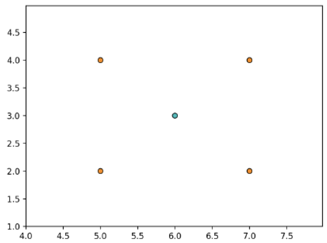
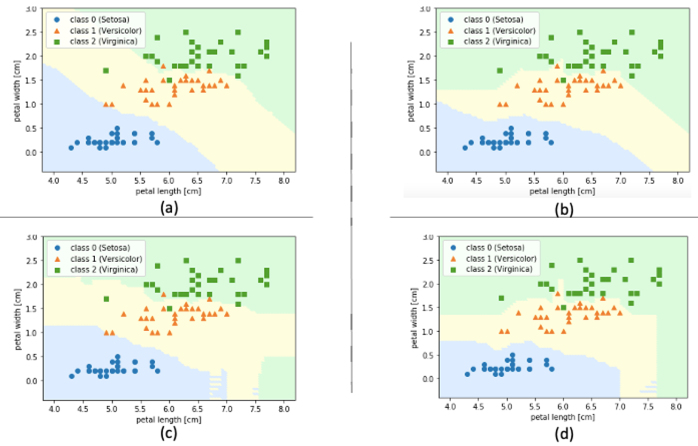
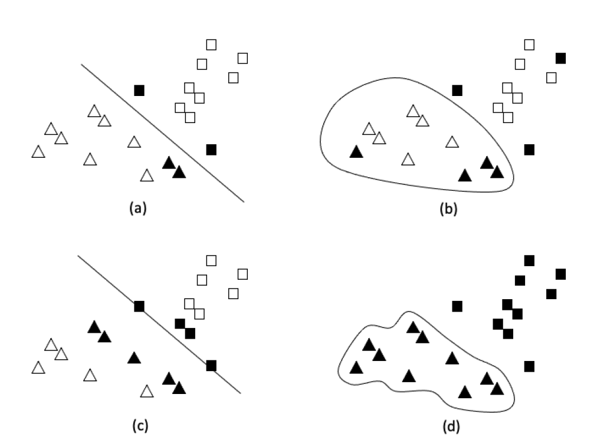
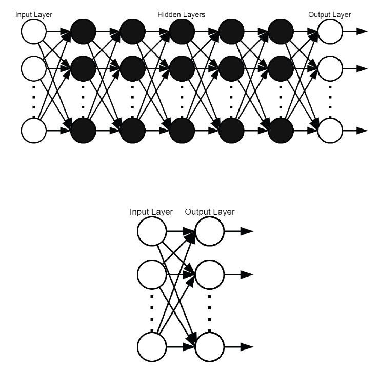
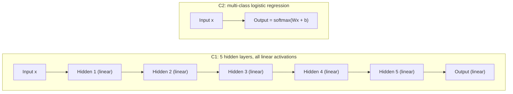
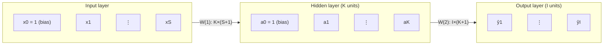
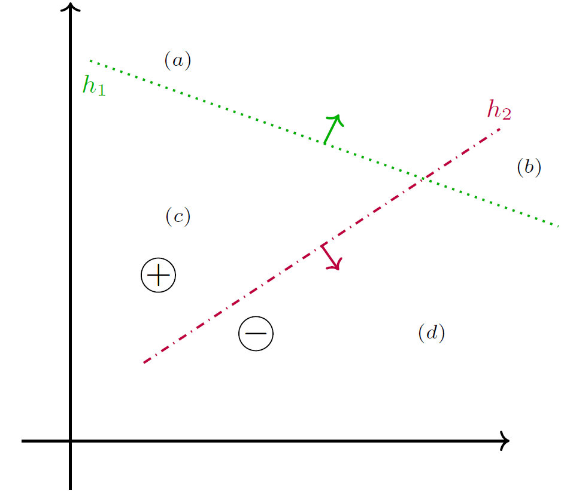

# Worksheet

## 1 $k$-means Algorithm

Consider eight data points: A1=(2,10), A2=(2,5), A3=(8,4), A4=(5,8), A5=(7,5), A6=(6,4), A7=(1,2), A8=(4,9). Perform $k$-means clustering with $k$=2 to group the eight points into clusters $C_1$ and $C_2$.

**假設：** 題目沒有給初始中心點，這裡取 $c_1$=A1=(2,10)、 $c_2$=A3=(8,4)，距離用 Euclidean（比較平方距離即可）。一次 iteration = 「指派 → 重算中心」。

### (A) What are the member points of $C_1$ and $C_2$ after one iteration of $k$-means?

***Ans***

| 點 | $d^2$ 到 $c_1$=(2,10) | $d^2$ 到 $c_2$=(8,4) | 指派 |
|---|---|---|---|
| A1 (2,10) | 0 | 72 | C1 |
| A2 (2,5) | 25 | 37 | C1 |
| A3 (8,4) | 72 | 0 | C2 |
| A4 (5,8) | 13 | 25 | C1 |
| A5 (7,5) | 50 | 2 | C2 |
| A6 (6,4) | 52 | 4 | C2 |
| A7 (1,2) | 65 | 53 | C2 |
| A8 (4,9) | 5 | 41 | C1 |

**第 1 次 iteration 後：** $C_1=\{A1,A2,A4,A8\}$， $C_2=\{A3,A5,A6,A7\}$

新中心： $c_1=\big(\tfrac{2+2+5+4}{4},\tfrac{10+5+8+9}{4}\big)=(3.25,\,8)$， $c_2=\big(\tfrac{8+7+6+1}{4},\tfrac{4+5+4+2}{4}\big)=(5.5,\,3.75)$

### (B) What are the member points of $C_1$ and $C_2$ after the second iteration of $k$-means?

***Ans***

| 點 | $d^2$ 到 (3.25, 8) | $d^2$ 到 (5.5, 3.75) | 指派 |
|---|---|---|---|
| A1 | 5.56 | 51.06 | C1 |
| A2 | 10.56 | 13.81 | C1 |
| A3 | 38.56 | 6.31 | C2 |
| A4 | 3.06 | 18.06 | C1 |
| A5 | 23.06 | 3.81 | C2 |
| A6 | 17.56 | 0.31 | C2 |
| A7 | 41.06 | 23.31 | C2 |
| A8 | 1.56 | 25.06 | C1 |

**第 2 次 iteration 後：** $C_1=\{A1,A2,A4,A8\}$， $C_2=\{A3,A5,A6,A7\}$，與第 1 次相同，中心點不再改變，**演算法已收斂**。

> 補充： $k$-means 對初始值敏感。若改用 A1、A2 當初始中心，兩次 iteration 都得到 $C_1=\{A1,A4,A8\}$ 、 $C_2=\{A2,A3,A5,A6,A7\}$ （SSE≈51.5，比上面的 54.5 更低）。實務上要多次隨機初始化（或 $k$-means++）取 SSE 最小者。

---

## 2 Agglomerative Clustering Algorithm

Consider the distance matrix shown below. Use agglomerative algorithm to group the data with the following agglomerate policy.

|    | A1 | A2 | A3 | A4 | A5 | A6 | A7 | A8 |
|----|----|----|----|----|----|----|----|----|
| A1 | 0  | 45 | 63 | 57 | 41 | 28 | 95 | 6  |
| A2 |    | 0  | 55 | 49 | 35 | 11 | 5  | 25 |
| A3 |    |    | 0  | 11 | 23 | 54 | 47 | 65 |
| A4 |    |    |    | 0  | 2  | 7  | 26 | 5  |
| A5 |    |    |    |    | 0  | 5  | 21 | 35 |
| A6 |    |    |    |    |    | 0  | 13 | 27 |
| A7 |    |    |    |    |    |    | 0  | 53 |
| A8 |    |    |    |    |    |    |    | 0  |

### (A) Perform agglomerative clustering with single-link and show its dendrogram.

***Ans***

單鏈： $d(C_i,C_j)=\min$ 成員間距離。

| 步驟 | 合併 | 高度 | 說明 |
|---|---|---|---|
| 1 | {A4, A5} | 2 | 全矩陣最小值 |
| 2 | {A2, A7} | 5 | 5 同時是 A2–A7、{A4,A5}–A6、{A4,A5}–A8 的距離（平手） |
| 3 | {A4,A5} + A6 → {A4,A5,A6} | 5 | min(A4–A6=7, A5–A6=5)=5 |
| 4 | {A4,A5,A6} + A8 → {A4,A5,A6,A8} | 5 | min(A4–A8=5, …)=5 |
| 5 | A1 + {A4,A5,A6,A8} | 6 | A1–A8=6 |
| 6 | {A2,A7} + {A1,A4,A5,A6,A8} | 11 | A2–A6=11 |
| 7 | A3 + 其餘 | 11 | A3–A4=11（與步驟 6 平手，順序可互換，最後都在 11） |

直覺：單鏈會產生「鏈狀（chaining）」效應，合併高度很低（2~11）。

### (B) Perform agglomerative clustering with complete-link and show its dendrogram.

***Ans***

完全鏈： $d(C_i,C_j)=\max$ 成員間距離。

| 步驟 | 合併 | 高度 | 計算 |
|---|---|---|---|
| 1 | {A4, A5} | 2 | |
| 2 | {A2, A7} | 5 | |
| 3 | {A1, A8} | 6 | |
| 4 | {A4,A5} + A6 | 7 | max(7, 5)=7 |
| 5 | {A2,A7} + {A4,A5,A6} | 49 | max(49,35,26,21,11,13)=49（其他候選：{A4,A5,A6}–A3=54、–{A1,A8}=57） |
| 6 | A3 + {A2,A4,A5,A6,A7} | 55 | max(55,47,11,23,54)=55（< A3–{A1,A8}=65） |
| 7 | {A1,A8} + 其餘 | 95 | A1–A7=95 |

### (C) Perform agglomerative clustering with average-link and show its dendrogram.

***Ans***

平均鏈： $d(C_i,C_j)=$ 所有跨群成對距離的平均。

| 步驟 | 合併 | 高度 | 計算 |
|---|---|---|---|
| 1 | {A4, A5} | 2 | |
| 2 | {A2, A7} | 5 | |
| 3 | {A1, A8} | 6 | |
| 4 | {A4,A5} + A6 | 6 | (7+5)/2=6（與步驟 3 平手，不影響結果） |
| 5 | {A2,A7} + {A4,A5,A6} | 25.83 | (49+35+11+26+21+13)/6=155/6 |
| 6 | A3 + {A2,A4,A5,A6,A7} | 38 | (55+47+11+23+54)/5=190/5 |
| 7 | {A1,A8} + 其餘 | 44.92 | 539/12（12 對距離總和 539） |

三種準則比較：single-link 最後在高度 11 全部合併；complete-link 與 average-link 會把 {A1,A8} 當成最後才併入的離群小群（高度 95 / 44.9），A3 次之。

---

## 3 Density-based Clustering Algorithm

Consider the same distance matrix in Question 2. Perform DBSCAN with Epsilon=10 and MinPoints=2 to cluster the eight points. Show the clustering process at each iteration, listing the clusters and their member points. Please highlight the points that are classified as outliers if any.

***Ans***

**約定：** 鄰域 $N_\varepsilon(p)=\{q: d(p,q)\le 10\}$ 且包含 $p$ 自己； $|N_\varepsilon(p)|\ge 2$ 即為核心點（core point）。

先算每個點的鄰域：

| 點 | $N_{10}$ | 大小 | 類型 |
|---|---|---|---|
| A1 | {A1, A8} | 2 | core |
| A2 | {A2, A7} | 2 | core |
| A3 | {A3} | 1 | **非核心，且不在任何核心點鄰域內 → outlier** |
| A4 | {A4, A5, A6, A8} | 4 | core |
| A5 | {A5, A4, A6} | 3 | core |
| A6 | {A6, A4, A5} | 3 | core |
| A7 | {A7, A2} | 2 | core |
| A8 | {A8, A1, A4} | 3 | core |

按 A1→A8 順序掃描：

| Iteration | 處理的點 | 動作 | 目前結果 |
|---|---|---|---|
| 1 | A1 | core，建立新群 C1，加入 A8 | C1={A1, A8} |
| 2 | 展開 A8 | A8 為 core，把 A4 納入 | C1={A1, A8, A4} |
| 3 | 展開 A4 | A4 為 core，納入 A5、A6 | C1={A1, A4, A5, A6, A8} |
| 4 | 展開 A5、A6 | 鄰居皆已在 C1，C1 完成 | C1={A1, A4, A5, A6, A8} |
| 5 | A2 | 尚未歸類，core，建立 C2，加入 A7 | C2={A2, A7} |
| 6 | 展開 A7 | 鄰居 A2 已在 C2，C2 完成 | C2={A2, A7} |
| 7 | A3 | 鄰域只有自己，不是 core；也未被任何 core 的鄰域涵蓋 | **A3 = outlier / noise** |
| 8 | A4…A8 | 皆已歸類 | 結束 |

**最終結果：**  $C_1=\{A1,A4,A5,A6,A8\}$， $C_2=\{A2,A7\}$，**Outlier（noise）＝ ${A3}$**。

> 若 MinPoints 不計入點本身（需 ≥2 個「其他」鄰居），則 A1、A2、A7 變成非核心點；結果為 $C_1=\{A1,A4,A5,A6,A8\}$（A1 為 border），A2、A3、A7 皆為 noise。

---

## 4 Cluster Evaluation

Evaluate and compare the clusters discovered in (i) the agglomerative clustering task with a single-link policy and (ii) DBSCAN using the internal measurement: Silhouette Coefficient. You may need to determine an appropriate cutting threshold for the agglomerative clustering task with a single-link policy.

**設定：** 單鏈合併高度為 2, 5, 5, 5, 6, 11, 11。在高度 6 與 11 之間有明顯的大跳躍，因此把切割門檻設在 **8**（落在 (6, 11) 內任何值結果相同；取 10 可與 DBSCAN 的 ε 對應），得到：

- (i) Single-link： $\{A1,A4,A5,A6,A8\}$、 $\{A2,A7\}$、 $\{A3\}$
- (ii) DBSCAN： $\{A1,A4,A5,A6,A8\}$、 $\{A2,A7\}$， $A3$ 為 noise

Silhouette： $`s(i)=\dfrac{b(i)-a(i)}{\max\lbrace a(i), b(i)\rbrace}`$， $a$＝與同群其他點的平均距離， $b$＝與最近的其他群的平均距離；單點群 $s=0$。

| 點 | Single-link $s(i)$ | DBSCAN $s(i)$（noise 不計） |
|---|---|---|
| A1 | 0.476 | 0.529 |
| A2 | 0.848 | 0.848 |
| A3 | 0（單點群） | — |
| A4 | −0.380 | 0.527 |
| A5 | 0.098 | 0.259 |
| A6 | −0.284 | −0.284 |
| A7 | 0.880 | 0.880 |
| A8 | 0.532 | 0.532 |
| 群 {A1,A4,A5,A6,A8} 平均 | 0.088 | 0.313 |
| 群 {A2,A7} 平均 | 0.864 | 0.864 |
| 群 {A3} 平均 | 0 | — |
| **整體平均** | **0.271** | **0.470** |

（例：A2 的 $a=5$， $b=\min\{(45+49+35+11+25)/5=33,\ 55\}=33$， $s=(33-5)/33=0.848$。單鏈中 A4 的 $b$ 是到單點群 {A3} 的距離 11，而 $a=(2+7+5+57)/4=17.75$，所以 $s=(11-17.75)/17.75=-0.38$。）

### (A) What does it mean if the silhouette coefficient is low/high at the individual level, cluster level, and overall clustering?

***Ans***

Silhouette 範圍為 [−1, 1]。

- **個別點：** 高（接近 1）＝與自己群很近、與鄰近群很遠，歸類恰當；接近 0＝落在兩群邊界上；為負＝平均而言離別的群比離自己的群更近，**很可能被分錯群**（例如 A6、A4）。
- **群層級（群內所有點的平均）：** 高＝群緊密且與其他群分離良好；低＝群鬆散、或與鄰群重疊／混在一起。群內有大量接近 0 或負值的點，代表此群可能該被拆開或合併。
- **整體（所有點的平均）：** 高（>0.5 通常算結構明確，>0.7 很強）＝整體分群結構清楚；低（<0.25）＝分群結構弱或群數 $k$ 不合適；接近 0 或負值＝群與群大量重疊。可用來比較不同演算法或不同 $k$。

### (B) Which clustering algorithm delivers the resulting clustering with the lowest and the highest silhouette coefficient?

***Ans***

- **最高：DBSCAN，整體 ≈ 0.470。**
- **最低：Single-link（門檻 8），整體 ≈ 0.271。**

原因：兩者的 {A1,A4,A5,A6,A8} 與 {A2,A7} 完全相同，差別只在 A3。Single-link 強制把 A3 當成單點群，而它使 A4 的最近鄰群變成 {A3}（ $b$ 變小，$s=-0.38$）；DBSCAN 把 A3 標成 noise 並排除，不拉低分數。
注意：若把 DBSCAN 的 noise 也當成一個群一起算，兩者結果會相同（0.271）。所以 DBSCAN 較高有一部分是「排除離群點」的結果，比較時要說明這一點。

### (C) Which clustering algorithm delivers balanced resulting clusters (i.e., each cluster has a similar number of points)?

***Ans***

**兩者都不平衡。** 單鏈的群大小為 5 / 2 / 1，DBSCAN 為 5 / 2（另有 1 個 noise），都是一個大群加一個小群。原因是這 8 個點在距離上本來就「一群密集、其餘稀疏」，而單鏈的鏈狀效應與 DBSCAN 的密度連通性都會把相連的點一路併成大群，而且兩者都不會刻意追求群大小相近。
若真的需要大小接近的群，應改用 $k$-means 一類以中心為基礎的方法，或 complete / average-link 在較高門檻下切割（例如 complete-link 切在 49–55 之間得到 {A1,A8}、{A2,A4,A5,A6,A7}、{A3}，仍不平衡但比較不會鏈狀）。

---

## 5 Anomaly Detection

### (A) Supervised outlier detection approaches build a classification model to classify unseen events. Discuss a major challenge that classification-based techniques must address. Explain how to resolve the specific challenge.

***Ans***

**主要挑戰：類別極度不平衡（class imbalance）。** 異常事件本來就稀少（常常 <1%），而且往往還有標註取得困難、新型態異常訓練時沒見過的問題。分類器若只追求整體準確率，會傾向把所有樣本都預測成「正常」，準確率高達 99% 卻抓不到任何異常。

**解法：**
1. **資料層面：** 對少數類 oversampling（如 SMOTE 合成樣本）、對多數類 undersampling，或兩者混合。
2. **演算法層面：** cost-sensitive learning，對漏報異常（FN）設定比誤報更高的代價／class weight；或 boosting 類方法並調整權重。
3. **改用 one-class 方法：** 只用正常資料學習邊界（One-Class SVM、autoencoder 重建誤差），可處理沒見過的新型異常。
4. **評估指標：** 不用 accuracy，改用 precision / recall / F1、PR curve、ROC-AUC，並調整決策門檻。

### (B) Proximity-based technique is one of the unsupervised learning approaches for point-based anomaly detection. Discuss a scenario where density-based outlier detection may fail. Explain how to resolve the specific case.

***Ans***

**失效情境：資料中同時含有密度差異很大的群（varying density）。** 例如一個很密的群 $C_1$ 與一個很稀疏的群 $C_2$：
- 若用單一全域門檻（固定的 ε、固定的鄰居密度門檻、或全域 kNN 距離），稀疏群 $C_2$ 內的**正常點**會因為密度低而被誤判為異常；
- 反過來，若為了保住 $C_2$ 而放寬門檻，緊鄰密集群 $C_1$ 邊緣、但相對於 $C_1$ 其實偏離的**真異常**會被當成正常而漏掉。

另一個常見失效：**masking / swamping**，一小團彼此靠近的異常點（數量 > $k$）自己形成「密度夠高」的小群，互相掩護而不被偵測。

**解法：** 改用**局部（相對）密度**。例如 **LOF（Local Outlier Factor）**：比較一個點的局部密度與其 $k$ 個鄰居的局部密度，$\text{LOF}\approx 1$ 為正常，$\gg 1$ 為異常，因此不受各群絕對密度影響；也可使用 relative kNN-distance、或 DBSCAN 的變體（如 OPTICS／HDBSCAN）處理不同密度，並適當選擇 $k$ 使其大於可能的異常小群大小以避免 masking。

---

## 6 ROC

Given the table below, plot the ROC curve for 0, 0.2, 0.4, 0.6, 0.8, and 1 on the graph in the answer booklet. Please explain whether you would choose to use Classifier 1 or Classifier 2 and why.

| Class | $Pr(P\|A)$ Classifier1 | $Pr(P\|A)$ for Classifier2 |
|-------|------|------|
| P     | 0.83 | 0.92 |
| N     | 0.78 | 0.62 |
| P     | 0.62 | 0.52 |
| N     | 0.48 | 0.49 |
| N     | 0.32 | 0.38 |
| N     | 0.22 | 0.28 |

***Ans***

資料中有 2 個 P、4 個 N。門檻 $t$：預測分數 $\ge t$ 為 Positive。$\text{TPR}=TP/2$，$\text{FPR}=FP/4$。

| 門檻 $t$ | C1：TP / FP | C1：(FPR, TPR) | C2：TP / FP | C2：(FPR, TPR) |
|---|---|---|---|---|
| 0 | 2 / 4 | (1, 1) | 2 / 4 | (1, 1) |
| 0.2 | 2 / 4 | (1, 1) | 2 / 4 | (1, 1) |
| 0.4 | 2 / 2 | (0.5, 1) | 2 / 2 | (0.5, 1) |
| 0.6 | 2 / 1 | (0.25, 1) | 1 / 1 | (0.25, 0.5) |
| 0.8 | 1 / 0 | (0, 0.5) | 1 / 0 | (0, 0.5) |
| 1 | 0 / 0 | (0, 0) | 0 / 0 | (0, 0) |


**哪一個分類器？**
- 兩個分類器對 6 筆資料的**排序完全相同**（P, N, P, N, N, N），因此**完整的 ROC 曲線相同，AUC 皆為 7/8 = 0.875**（8 組 P–N 配對中有 7 組排對）。ROC／AUC 只看排序，所以僅靠 ROC 無法分出高下。
- 圖上點位不同只是因為取樣的門檻格點（0, 0.2, …）落在不同分數之間；例如 $t=0.6$ 時 C2 的 0.52 低於門檻而漏掉一個 P。
- 若一定要選，我會選 **Classifier 1**：它在「最後一個 P（0.62）」與「其後最高的 N（0.48）」之間有 0.14 的分數間隔，而 C2 只有 0.52 vs 0.49，間隔僅 0.03。因此 C1 在 $t\approx0.5$–0.6 的操作點對門檻擾動較穩健，且在題目要求的格點上（$t=0.6$）給出較佳的 (FPR, TPR)=(0.25, 1)。
- 補充：只有 6 筆資料，AUC 的差異本來就不具統計意義；實務上應在更大的驗證集上比較。

---

## 7 Evaluation Protocols

You will evaluate a fixed classifier on a binary classification dataset using four protocols: 2-fold CV, 10-fold CV, Leave-One-Out CV (LOOCV), and a single 70%/30% train/validation split. Unless otherwise stated, assume i.i.d. samples and use stratified splits to preserve class ratios.

### (A) What effect will this have on your results?

***Ans***

選擇不同的評估協定，會改變估計值的**偏差（bias）**與**變異（variance）**，以及運算成本（對「同一個固定分類器架構」而言，估計到的是測試誤差）：

| 協定 | 訓練集占比 | 估計的偏差 | 估計的變異 | 備註 |
|---|---|---|---|---|
| 2-fold CV | 50% | **偏差最大**（訓練資料少 → 效能被低估，悲觀） | 中等 | 每筆資料都被測一次 |
| 10-fold CV | 90% | 小 | 中等偏低 | 最常用的折衷 |
| LOOCV | $(n-1)/n$ | **偏差最小**（幾乎無偏） | **偏高**：$n$ 個訓練集幾乎相同，各折結果高度相關 | 運算最貴 |
| 單次 70/30 | 70% | 中（用 70% 訓練 → 略悲觀） | **最大**：結果取決於這一次怎麼切，且測試集只有 30% | 最快 |

總結：折數越多 → 偏差越小、運算越貴；單次切割則變異大、可能因切分運氣而偏樂觀或偏悲觀。分層（stratified）可降低因類別比例不同造成的額外變異。

### (B) Which will give you the best representative value to the "unseen test set"?

***Ans***

**Stratified 10-fold CV**（必要時重複多次，repeated stratified 10-fold）。它在偏差（訓練集有 90% 資料，接近最終模型）與變異（平均 10 次估計）之間取得最好的平衡。LOOCV 偏差最小，但變異大、成本高；2-fold 偏差太大；單次 70/30 估計太不穩定。
最終仍應保留一份從未參與調參的獨立測試集，作為對「unseen test set」最誠實的估計；CV 用於模型選擇與調參。

### (C) Does it matter how large your original dataset is? Will you get a different answer for a very large or a tiny dataset?

***Ans***

**會，資料量會改變最佳選擇：**
- **很小的資料集（例如 <100 筆）：** 不能浪費資料，hold-out 30% 與 2-fold 都會讓訓練集太小、估計偏差變大且很雜訊。較佳選擇是 LOOCV 或 repeated / stratified 10-fold（甚至 repeated 5×2…），LOOCV 計算量在小資料下可以接受。
- **很大的資料集（例如百萬筆）：** 訓練集比例對偏差的影響很小，單次 hold-out 的測試集本身就夠大，信賴區間很窄，所以 70/30（甚至 90/10）就夠；而 10-fold 與 LOOCV 成本太高，LOOCV 基本不可行。折數可降到 3–5。
- 中間規模：10-fold CV 最合適。

### (D) Which will be the fastest in terms of computation?

***Ans***

**單次 70%/30% split 最快**，只需訓練 1 次（訓練 70% 的資料）。依成本排序：70/30（1 次訓練）< 2-fold（2 次，各用 50%）< 10-fold（10 次，各用 90%）< LOOCV（$n$ 次，各用 $n-1$ 筆，最慢）。

---

## 8 Normalization

Suppose that we have some 8-bit grayscale image data encoded as a matrix:

$$
X = \begin{bmatrix}
0 & 0 & 255 & 120 \\
0 & 56 & 56 & 25 \\
40 & 200 & 186 & 15 \\
78 & 160 & 55 & 0
\end{bmatrix}
$$

Use Min-Max scaling to normalize these data to the interval [0, 1] (represented using real numbers).

***Ans***

公式：$x'=\dfrac{x-x_{\min}}{x_{\max}-x_{\min}}$，其中 $x_{\min}=0$、$x_{\max}=255$，所以 $x'=x/255$。

$$
X' \approx \begin{bmatrix}
0 & 0 & 1 & 0.4706 \\
0 & 0.2196 & 0.2196 & 0.0980 \\
0.1569 & 0.7843 & 0.7294 & 0.0588 \\
0.3059 & 0.6275 & 0.2157 & 0
\end{bmatrix}
$$

（例：$120/255=0.4706$，$56/255=0.2196$，$200/255=0.7843$，$186/255=0.7294$，$160/255=0.6275$。）

---

## 9 PCA

Given 3 data points in two-dimensional space, (1, 1), (2, 2), and (3, 3),

### (A) What is the first principal component?

***Ans***

平均值 $\mu=(2,2)$，中心化後的資料為 $(-1,-1),(0,0),(1,1)$。共變異數矩陣（1/N 版）

$$
\Sigma=\frac13\sum x x^T=\begin{bmatrix}2/3&2/3\\2/3&2/3\end{bmatrix}
$$

特徵值 $\lambda_1=4/3$、$\lambda_2=0$（使用 $1/(N-1)$ 時為 2 與 0）。對應 $\lambda_1$ 的特徵向量：

$$
\mathbf{u}_1=\tfrac{1}{\sqrt2}\,(1,\,1)^T \approx (0.707,\,0.707)^T
$$

即第一主成分是沿 $y=x$ 的方向（正負號均可，$-\mathbf{u}_1$ 也成立）。因為三點共線，第二主成分 $(1,-1)/\sqrt2$ 的變異為 0。

### (B) If we want to project the original data points into a 1-d space by the main component you choose, what is the variance of the projected data?

***Ans***

投影座標 $z_i=\mathbf{u}_1^T(x_i-\mu)$：$-\sqrt2,\ 0,\ \sqrt2$，平均為 0。

- 母體變異（除以 $N$）：$\dfrac{2+0+2}{3}=\dfrac43\approx1.333$ （＝$\lambda_1$）
- 樣本變異（除以 $N-1$）：$\dfrac{2+0+2}{2}=2$

答案：**$4/3$**（採 $1/N$ 約定；若課程使用 $1/(N-1)$ 則為 2）。因為資料完全落在一條直線上，這個 1 維投影保留了 **100%** 的變異，無資訊損失。

---

## 10 Decision Tree

We consider a toy dataset from an online retail e-commerce platform. The task is to predict whether an order qualifies for free shipping (binary class {T, F}) based on three Boolean features: `IsPrimeMember`, `Over$35Cart`, and `IsMarketplaceSeller`.

| ID | IsPrimeMember | Over\$35Cart | IsMarketplaceSeller | Class |
|----|---------------|-------------|---------------------|-------|
| 1  | 1 | 0 | 0 | T |
| 2  | 1 | 0 | 1 | F |
| 3  | 0 | 1 | 0 | F |
| 4  | 1 | 1 | 1 | F |
| 5  | 1 | 1 | 0 | T |

### (A) What is the entropy of the root node? Show your working.

***Ans***

5 筆資料中 T = 2（ID 1, 5）、F = 3（ID 2, 3, 4）：

$$
H(\text{root})=-\tfrac25\log_2\tfrac25-\tfrac35\log_2\tfrac35=0.4\times1.3219+0.6\times0.7370\approx \mathbf{0.971\ bits}
$$

### (B) Draw the complete decision tree.

***Ans***

**第一層：計算每個特徵的 Information Gain**

| 特徵 | 值=1 的子集（T/F） | 值=0 的子集（T/F） | 加權熵 | IG |
|---|---|---|---|---|
| IsPrimeMember | {1,2,4,5}：2T 2F → H=1 | {3}：0T 1F → H=0 | $\frac45\cdot1=0.800$ | 0.971−0.800=**0.171** |
| Over$35Cart | {3,4,5}：1T 2F → H=0.918 | {1,2}：1T 1F → H=1 | $\frac35(0.918)+\frac25(1)=0.951$ | **0.020** |
| IsMarketplaceSeller | {2,4}：0T 2F → H=0 | {1,3,5}：2T 1F → H=0.918 | $\frac35(0.918)=0.551$ | **0.420** ← 最大 |

→ 根節點分裂於 **IsMarketplaceSeller**。

**第二層：** 左分支（Marketplace=1）已純：全為 F。右分支（Marketplace=0）剩 {1:T, 3:F, 5:T}（H=0.918）：

- 用 IsPrimeMember：=1 → {1,5} 全 T；=0 → {3} 為 F ⇒ 兩邊皆純，加權熵 0，IG=0.918
- 用 Over$35Cart：=0 → {1} T；=1 → {3:F, 5:T} 不純 ⇒ IG 較小

→ 選 **IsPrimeMember**。

```
                 IsMarketplaceSeller?
                 /                  \
              =1                     =0
               |                      |
            Class = F           IsPrimeMember?
                                /           \
                             =1              =0
                              |               |
                          Class = T        Class = F
```

此樹對 5 筆訓練資料全部分類正確（訓練錯誤率 0）：Class = T ⇔ IsPrimeMember=1 **且** IsMarketplaceSeller=0。

### (C) Are there feature(s) that are redundant?

***Ans***

**有：`Over$35Cart` 是冗餘的。** 它的 IG 在第一層最低（0.020），而且在整棵完整樹中完全沒被用到；僅用 IsMarketplaceSeller 與 IsPrimeMember 就能把訓練資料完全分開（$T \Leftrightarrow \text{Prime}\wedge\neg\text{Marketplace}$）。
（註：這是以此 5 筆玩具資料為依據；現實中「購物車超過 35 美元」通常與免運直接相關，資料筆數太少才使它看起來無用。）

---

## 11 Decision Tree

Consider the matrix below, which summarizes six online orders. Each column of $M^T$ is one order (sample), and each row is a feature:

$f_1$ = a normalized Order Value Index (110),

$f_2$ = a normalized Items per Order Index (110), and

$f_3$ = a normalized Account Tenure Index (110).

The label vector indicates whether an order is flagged for manual review (1) or not (0).

$$
M = \begin{bmatrix}
3 & 5 & 8 & 1 & 6 & 4 \\
2 & 7 & 6 & 3 & 4 & 5 \\
5 & 7 & 9 & 2 & 8 & 6
\end{bmatrix}
$$

where $M^T$ represents 6 sample points, each with three features $f_1$, $f_2$, and $f_3$.

The data labels are

$$
\begin{bmatrix} 1 & 0 & 1 & 0 & 1 & 0 \end{bmatrix}^T
$$

We would like to build a decision tree of depth 2 by hand to classify the data.

**整理成樣本表：**

| 樣本 | $f_1$ | $f_2$ | $f_3$ | $y$ |
|---|---|---|---|---|
| s1 | 3 | 2 | 5 | 1 |
| s2 | 5 | 7 | 7 | 0 |
| s3 | 8 | 6 | 9 | 1 |
| s4 | 1 | 3 | 2 | 0 |
| s5 | 6 | 4 | 8 | 1 |
| s6 | 4 | 5 | 6 | 0 |

### (A) What is the entropy of the root node? Show your working.

***Ans***

3 個 1、3 個 0：

$$H(\text{root})=-\tfrac12\log_2\tfrac12-\tfrac12\log_2\tfrac12=\mathbf{1\ bit}$$

### (B) What is the rule for the first split? (Write it in a rule format, e.g., $f_1$ > 2.) Show your working.

***Ans***

對每個特徵，取相鄰排序值的中點作為候選門檻，計算 IG：

| 特徵 / 門檻 | 左 (≤) 標籤 | 右 (>) 標籤 | 加權熵 | IG |
|---|---|---|---|---|
| $f_1$ ≤ 2 | {0} | {1,0,0,1,1} | 0.809 | 0.191 |
| $f_1$ ≤ 3.5 | {0,1} | {0,0,1,1} | 1 | 0 |
| $f_1$ ≤ 4.5 | {0,1,0} | {0,1,1} | 0.918 | 0.082 |
| **$f_1$ ≤ 5.5** | {0,1,0,0} | {1,1} | $\frac46(0.811)+0=0.541$ | **0.459** |
| $f_1$ ≤ 7 | {0,1,0,0,1} | {1} | 0.809 | 0.191 |
| $f_2$ ≤ 2.5 / 3.5 / 4.5 / 5.5 / 6.5 | — | — | 0.809 / 1 / 0.918 / 1 / 0.809 | 0.191 / 0 / 0.082 / 0 / 0.191 |
| $f_3$ ≤ 3.5 | {0} | {1,0,0,1,1} | 0.809 | 0.191 |
| $f_3$ ≤ 5.5 | {0,1} | {0,0,1,1} | 1 | 0 |
| $f_3$ ≤ 6.5 | {0,1,0} | {0,1,1} | 0.918 | 0.082 |
| **$f_3$ ≤ 7.5** | {0,1,0,0} | {1,1} | 0.541 | **0.459** |
| $f_3$ ≤ 8.5 | {0,1,0,0,1} | {1} | 0.809 | 0.191 |

最大 IG = 0.459，由 $f_1$ 與 $f_3$ 平手；兩者產生的**分割完全相同**（右邊都是 {s3, s5}，皆為 1，純）。

**第一個分裂規則： $f_1 > 5.5$ ⟹ 預測 1**（等價地可寫成 $f_3 > 7.5$）。
- 右分支（$f_1>5.5$）：{s3, s5}，全為 1，熵 0 → 葉節點，預測 1
- 左分支（$f_1\le5.5$）：{s1:1, s2:0, s4:0, s6:0}，熵 0.811，需要繼續分裂

### (C) What is the rule for the second split? Show your working.

***Ans***

只考慮左分支 {s1, s2, s4, s6}（熵 0.811）：

| 特徵 / 門檻 | 左 / 右 標籤 | 加權熵 | IG |
|---|---|---|---|
| $f_1$ ≤ 2 | {0} / {1,0,0} | 0.689 | 0.122 |
| $f_1$ ≤ 3.5 | {0,1} / {0,0} | 0.5 | 0.311 |
| $f_1$ ≤ 4.5 | {0,1,0} / {0} | 0.689 | 0.122 |
| **$f_2$ ≤ 2.5** | **{1} / {0,0,0}** | **0** | **0.811** ← 最大 |
| $f_2$ ≤ 4 | {1,0} / {0,0} | 0.5 | 0.311 |
| $f_2$ ≤ 6 | {1,0,0} / {0} | 0.689 | 0.122 |
| $f_3$ ≤ 3.5 | {0} / {1,0,0} | 0.689 | 0.122 |
| $f_3$ ≤ 5.5 | {0,1} / {0,0} | 0.5 | 0.311 |

**第二個分裂規則： $f_2 > 2.5$ ⟹ 預測 0**（$f_2\le2.5$ ⟹ 預測 1）。兩個子節點都純。

最終深度 2 的樹：

```
            f1 > 5.5 ?
            /        \
         yes          no
          |            |
      predict 1     f2 > 2.5 ?
                    /        \
                 yes          no
                  |            |
              predict 0    predict 1
```

驗證：s1(f1=3,f2=2)→1 ✓；s2(5,7)→0 ✓；s3(f1=8)→1 ✓；s4(1,3)→0 ✓；s5(f1=6)→1 ✓；s6(4,5)→0 ✓，訓練準確率 100%。

### (D) Should you have a third split? Explain your answer.

***Ans***

**不需要。** 深度 2 的樹所有葉節點都是純的（熵 = 0），訓練資料已被完全分類。再往下分裂 Information Gain 為 0，沒有任何改善，只會讓樹更複雜、增加對 6 筆小樣本過度擬合的風險（違反 Occam's razor）。

---

## 12 Linear Regression

Suppose that we have a regularized form of linear regression, where we wish to minimize the following loss:

$$
L(w) = \frac{1}{N}\sum_{i=1}^{N}\left(y_i - (w^T x_i + b)\right)^2 + \gamma \|w\|_2^2
$$

As we increase $\gamma$ from 0 to infinity, describe how each of the following changes:

### (A) the model's overfitting behaviour,

***Ans***

$\gamma=0$ 時就是一般最小平方法，模型最有彈性，若特徵多或資料少容易**過擬合**（訓練誤差低、測試誤差高）。隨著 $\gamma$ 增大，L2 懲罰限制了模型複雜度，**過擬合逐漸減輕**；但若 $\gamma$ 太大，模型會變得過於簡單而**欠擬合**（訓練與測試誤差都高）。測試誤差通常呈 U 形，最佳 $\gamma$ 以交叉驗證選取。

### (B) the values and magnitude of $w$,

***Ans***

$\|w\|_2$ 會隨 $\gamma$ 增加而**單調遞減**：各係數往 0 **收縮（shrinkage）**，但（與 L1/Lasso 不同）對有限的 $\gamma$ 不會剛好變成 0，只是變小。極限 $\gamma\to\infty$ 時 $w\to\mathbf 0$，而不受懲罰的截距 $b\to\bar y$，模型退化為常數預測。閉式解 $w=(X^TX+N\gamma I)^{-1}X^Ty$（資料已中心化時），也顯示 $\gamma$ 增大使係數縮小並讓矩陣更穩定（對共線性有幫助）。

### (C) the bias and variance of the model (Note: here bias is not referring to b).

***Ans***

**偏差（bias）上升、變異（variance）下降。** $\gamma=0$：低偏差、高變異；$\gamma$ 增大：模型被限制，對訓練資料的擾動較不敏感 → 變異下降，但無法貼近真實函數 → 偏差上升；$\gamma\to\infty$：預測為常數，變異 → 0、偏差最大。最佳 $\gamma$ 落在兩者的折衷點（bias–variance tradeoff）。

---

## 13 Naïve Bayes

### (A) Assume that the following likelihoods for each word are part of a positive or negative movie review and equal prior probabilities for each class. What class will Naïve Bayes assign to the sentence "I always like sci-fi movies."?

|        | pos  | neg  |
|--------|------|------|
| I      | 0.09 | 0.16 |
| always | 0.07 | 0.06 |
| like   | 0.29 | 0.06 |
| sci-fi | 0.04 | 0.15 |
| movies | 0.08 | 0.11 |

***Ans***

事先機率相等（0.5 / 0.5），可直接比較似然乘積：

$$
P(\text{pos})\prod = 0.5\times(0.09\cdot0.07\cdot0.29\cdot0.04\cdot0.08)=0.5\times5.846\times10^{-6}=2.92\times10^{-6}
$$

$$
P(\text{neg})\prod = 0.5\times(0.16\cdot0.06\cdot0.06\cdot0.15\cdot0.11)=0.5\times9.504\times10^{-6}=4.75\times10^{-6}
$$

$4.75\times10^{-6} > 2.92\times10^{-6}$，正規化後 $P(\text{pos}\mid s)\approx0.381$，$P(\text{neg}\mid s)\approx0.619$。

**Naïve Bayes 判為 Negative（neg）。** 雖然 "like" 強烈偏向正面（0.29 vs 0.06），但 "I"、"sci-fi"、"movies" 的負面似然較高，累積後勝出。

### (B) Suppose that you are trying to solve a binary classification problem, and your data set has four attributes. Each attribute can take three possible values. If you modeled the full joint distribution of the attributes and the class label, how many parameters would you need?

***Ans***

聯合分佈 $P(X_1,X_2,X_3,X_4,Y)$ 的格子數為 $3^4\times2=81\times2=162$。機率總和須為 1，少一個自由度，所以需要 **$162-1=\mathbf{161}$ 個參數**。
（對照：Naïve Bayes 只需 $P(Y)$ 的 1 個參數，加上每個類別、每個屬性各 $3-1=2$ 個參數：$1+2\times4\times2=17$ 個。這就是條件獨立假設換來的參數量縮減。）

---

## 14 Naïve Bayes

You are hiking a section of the Appalachian Trail in the United States. Along the way, you notice various wild berries. Some are safe, while others are not. Using fictitious prior knowledge in the following table (Note: The table is entirely fabricated and does not reflect real life; do not use it to identify wild berries), determine which berries are poisonous.

| Example | IsRound | IsBlueOrPurple | IsClustered | HasCalyxCrown | Poisonous |
|---------|---------|----------------|-------------|---------------|-----------|
| A | 1 | 1 | 0 | 1 | - |
| B | 0 | 1 | 1 | 0 | + |
| C | 1 | 0 | 1 | 0 | + |
| D | 1 | 0 | 0 | 0 | - |
| E | 0 | 1 | 0 | 1 | - |
| F | 1 | 1 | 1 | 0 | + |
| G | 1 | 0 | 0 | 1 | - |
| H | 0 | 0 | 1 | 0 | + |

### (A) Train your classifier on the labeled data (A-H). Compute and report the eight conditional probabilities of attributes given the class values (e.g., $P(\text{IsRound} \mid \neg \text{Poisonous})$) and the class priors.

***Ans***

類別：Poisonous(+) = {B, C, F, H}（4 筆），¬Poisonous(−) = {A, D, E, G}（4 筆）。

**Class priors：** $P(+)=4/8=0.5$，$P(-)=4/8=0.5$

| 條件機率 | 計算 | 值 |
|---|---|---|
| $P(\text{IsRound}\mid +)$ | B0 C1 F1 H0 → 2/4 | **0.5** |
| $P(\text{IsBlueOrPurple}\mid +)$ | B1 C0 F1 H0 → 2/4 | **0.5** |
| $P(\text{IsClustered}\mid +)$ | B1 C1 F1 H1 → 4/4 | **1.0** |
| $P(\text{HasCalyxCrown}\mid +)$ | B0 C0 F0 H0 → 0/4 | **0** |
| $P(\text{IsRound}\mid -)$ | A1 D1 E0 G1 → 3/4 | **0.75** |
| $P(\text{IsBlueOrPurple}\mid -)$ | A1 D0 E1 G0 → 2/4 | **0.5** |
| $P(\text{IsClustered}\mid -)$ | A0 D0 E0 G0 → 0/4 | **0** |
| $P(\text{HasCalyxCrown}\mid -)$ | A1 D0 E1 G1 → 3/4 | **0.75** |

### (B) You have no labels for U and V. Using a naive Bayes classifier trained in (A), predict the labels for berries U and V. Try both without and with smoothing corrections.

| Example | IsRound | IsBlueOrPurple | IsClustered | HasCalyxCrown | Poisonous |
|---------|---------|----------------|-------------|---------------|-----------|
| U | 1 | 1 | 0 | 0 | ? |
| V | 1 | 0 | 0 | 1 | ? |

***Ans***

**(1) 無平滑（MLE）**，分數 $=P(c)\prod_k P(x_k\mid c)$（0 的屬性機率取 $1-P$）：

- **U = (1,1,0,0)**
  - $+$：$0.5\times0.5\times0.5\times(1-1.0)\times(1-0)=0.5\times0.5\times0.5\times0\times1=\mathbf{0}$
  - $-$：$0.5\times0.75\times0.5\times(1-0)\times(1-0.75)=0.5\times0.75\times0.5\times1\times0.25=\mathbf{0.0469}$
  - ⇒ 預測 **−（not poisonous）**
- **V = (1,0,0,1)**
  - $+$：$0.5\times0.5\times(1-0.5)\times(1-1.0)\times0=\mathbf{0}$
  - $-$：$0.5\times0.75\times0.5\times1\times0.75=\mathbf{0.1406}$
  - ⇒ 預測 **−（not poisonous）**

問題：IsClustered 在 − 類為 0、HasCalyxCrown 在 + 類為 0，造成「一個 0 就把整個乘積抹成 0」，+ 的分數被這些 0 直接否決，這是零機率問題。

**(2) Laplace（add-1）平滑**：$P(x=1\mid c)=\dfrac{n_{1,c}+1}{n_c+2}$（每個二元屬性 2 個取值，$n_c=4$）

| 條件機率 | 平滑後 |
|---|---|
| $P(\text{Round}=1\mid+)$ | 3/6 = 0.5 |
| $P(\text{Blue}=1\mid+)$ | 3/6 = 0.5 |
| $P(\text{Clustered}=1\mid+)$ | 5/6 ≈ 0.833 |
| $P(\text{Calyx}=1\mid+)$ | 1/6 ≈ 0.167 |
| $P(\text{Round}=1\mid-)$ | 4/6 ≈ 0.667 |
| $P(\text{Blue}=1\mid-)$ | 3/6 = 0.5 |
| $P(\text{Clustered}=1\mid-)$ | 1/6 ≈ 0.167 |
| $P(\text{Calyx}=1\mid-)$ | 4/6 ≈ 0.667 |

- **U = (1,1,0,0)**
  - $+$：$0.5\times0.5\times0.5\times(1-0.833)\times(1-0.167)=0.5\times0.5\times0.5\times0.1667\times0.8333=\mathbf{0.0174}$
  - $-$：$0.5\times0.667\times0.5\times(1-0.167)\times(1-0.667)=0.5\times0.667\times0.5\times0.8333\times0.3333=\mathbf{0.0463}$
  - 正規化：$P(+\mid U)\approx0.273$，$P(-\mid U)\approx0.727$ ⇒ 預測 **−**
- **V = (1,0,0,1)**
  - $+$：$0.5\times0.5\times0.5\times0.1667\times0.1667=\mathbf{0.00347}$
  - $-$：$0.5\times0.667\times0.5\times0.8333\times0.667=\mathbf{0.0926}$
  - 正規化：$P(+\mid V)\approx0.036$，$P(-\mid V)\approx0.964$ ⇒ 預測 **−**

**結論：** 無論有無平滑，U 與 V 都被判為 **not poisonous（−）**；平滑後 + 不再被硬性歸零，機率估計較合理（U 有約 27% 的毒性機率，較不確定；V 非常確定是 −）。

---

## 15 $k$-Nearest Neighbors

Consider $k$-NN using Euclidean distance on the following dataset, where each point belongs to one of two classes: red or blue.

<p align="center">
  
  <br>
  <em>Figure 1: Scatter Plot</em>
</p>

資料（讀自圖）：紅（圖中為橘色）4 點：(5,4)、(7,4)、(5,2)、(7,2)；藍（圖中為青色）1 點：(6,3)。

### (A) Please draw the decision boundary for the following dataset using the 1-NN classification rule.

***Ans***

1-NN 的決策邊界是各點 Voronoi 區域的邊界。藍點 (6,3) 與四個紅點之間的**垂直平分線**為：

| 對象 | 垂直平分線 | 藍色一側 |
|---|---|---|
| (5,4) | $x-y=2$ | $x-y>2$ |
| (7,4) | $x+y=10$ | $x+y<10$ |
| (5,2) | $x+y=8$ | $x+y>8$ |
| (7,2) | $x-y=4$ | $x-y<4$ |

所以**藍色區域是一個旋轉 45° 的正方形（菱形）**，頂點為 **(5,3)、(6,4)、(7,3)、(6,2)**，其餘整個平面預測為紅色。決策邊界就是這個菱形的四條邊（紅點之間的 Voronoi 邊界同類，不構成決策邊界）。


### (B) Would the decision boundary be different if another blue point was added to the data set at (6.1; 3.1)? Why or why not?

***Ans***

**會不同。** 1-NN 的邊界由所有訓練點決定，新增的藍點會產生自己的 Voronoi 區域，並與原藍點的區域合併（同類不畫邊界）。新點 (6.1, 3.1) 往右上偏移了 (0.1, 0.1)，所以藍色區域**略向右上方擴張**（朝 (7,4) 與 (7,2) 那一側），其餘靠左的邊界不變。

例：點 $q=(6.6,3.4)$ 原本在 $x+y=10$ 的邊界上（與藍點 (6,3) 及紅點 (7,4) 等距，$d^2=0.52$），新增後距新藍點 $d^2=0.34$ 更近，因此被判為藍色；邊界確實移動了（圖中菱形的右上與右下兩邊被推出去，並出現新的轉折）。


---

## 16 Decision Boundaries

Consider the following $k$-NN classification decision boundaries (a)-(d) as a result of different values of $k$ and distance metrics. The three classes of training data are represented by {red, green, yellow}, respectively. Please match each decision boundary with the most possible $k$-NN settings below (A)-(D) and briefly provide the justification for your pairing. (Note: Euclidean and Manhattan distance measures can be formally defined as follows.)

- Euclidean distance is defined as the square root of the sum of the squared differences between the coordinates of a pair of points x and y on a $D$-dimensional plane.

$$
d_E(x, y) = \sqrt{\sum_{1}^{D} (x_i - y_i)^2}
$$

- Manhattan distance is defined as the absolute differences between coordinates of pair of points $x$ and $y$ on $D$-dimensional plane.

$$
d_M(x, y) = \sum_{1}^{D} |(x_i - y_i)|
$$

<p align="center">
  
  <br>
  <em>Figure 2: Decision Boundary</em>
</p>

**判斷依據：**
1. **距離度量：** Euclidean 的等距線是圓，Voronoi 邊界為任意角度的斜線／平滑曲線；Manhattan 的等距線是菱形，邊界以水平、垂直、45° 的折線為主，圖形呈「階梯／方塊狀」。→ (a)(b) 是斜向平滑邊界 ⇒ Euclidean；(c)(d) 是水平垂直的直角邊界 ⇒ Manhattan。
2. **$k$ 值：** $k=1$ 時每個訓練點都自成一個小區域，邊界很貼資料、鋸齒狀，並有被離群點「挖出」的小島／尖刺（例如 (6.0, 1.5–1.8) 附近的綠色尖角）；$k=15$ 時多數決使邊界平滑、忽略個別離群點。

| 圖 | 觀察 | 對應設定 |
|---|---|---|
| (a) | 斜向、很平滑，沒有被離群點影響（如 (4.9, 1.7) 的綠點不產生小島） | **(B) $k=15$, Euclidean** |
| (b) | 斜向但較曲折，邊界貼著個別資料點，有小凹凸與孤立點的影響 | **(A) $k=1$, Euclidean** |
| (c) | 水平／垂直的直角邊界，且邊界相對平滑（如藍/黃交界是一條水平線） | **(D) $k=15$, Manhattan** |
| (d) | 直角邊界，且有尖刺與階梯狀凹凸（如 $x\approx6$ 處的垂直尖角、$x\approx7$ 的垂直邊） | **(C) $k=1$, Manhattan** |

### (A) $k$ = 1, Euclidean Distance.

***Ans***

**對應 (b)。** 斜向邊界（Euclidean）且曲折、貼合個別訓練點（$k=1$，低偏差高變異）。

### (B) $k$ = 15, Euclidean Distance.

***Ans***

**對應 (a)。** 斜向邊界且最平滑（$k=15$ 多數決平均掉雜訊與離群點）。

### (C) $k$ = 1, Manhattan Distance.

***Ans***

**對應 (d)。** 直角（軸向對齊）邊界，並且鋸齒、有尖刺（$k=1$）。

### (D) $k$ = 15, Manhattan Distance.

***Ans***

**對應 (c)。** 直角邊界但較平滑、較大的矩形區塊（$k=15$）。

---

## 17 Bias and Variance

As $k$ in the $k$-NN model increases, what behavior would you expect for bias and variance? Please provide your justification for your answer.

***Ans***

**$k$ 增大 ⟹ 偏差（bias）上升、變異（variance）下降。**
- $k$ 小（如 1）：預測只取決於極少數近鄰，決策邊界非常貼合訓練資料 → **低偏差、高變異**（對雜訊與訓練集的小改動敏感，訓練誤差為 0，容易過擬合）。
- $k$ 大：預測是更多鄰居的多數決／平均，邊界變平滑，個別雜訊被平均掉 → **變異下降**；但同時鄰居涵蓋更廣、會混入其他類別的點，模型變得過於簡單，無法貼近真實的複雜邊界 → **偏差上升**（欠擬合）。極端 $k=N$ 時，永遠預測多數類，變異 0、偏差最大。
- 測試誤差對 $k$ 通常呈 U 形，最佳 $k$ 由交叉驗證挑選（二元分類常取奇數以避免平手）。

---

## 18 Linearly Separable Data: Hard-margin SVMs

Recall that the desirable decision boundary in linear hard-margin SVMs is the linear hyperplane that maximizes the distance/margin from its closest points. Please complete the following questions with your reasons provided.

$$
\max_{w,b} \frac{2}{\|w\|_2^2} \quad \text{s.t. } (w \cdot x_i + b)y_i \ge 1 \quad \forall i = 1, \ldots, n.
$$

（註：margin 實際為 $2/\|w\|_2$，等價於 $\min \tfrac12\|w\|_2^2$。）

### (A) True or False? The linear hyperplane is defined by support vectors.

***Ans***

**True。** 在對偶解中 $w=\sum_i\alpha_i y_i x_i$，只有支持向量（恰好落在 margin 上、$y_i(w\cdot x_i+b)=1$）的 $\alpha_i>0$，其他點的 $\alpha_i=0$；$b$ 也由支持向量決定。所以超平面完全由支持向量決定。

### (B) True or False? Moving points other than support vectors a little do not affect the decision boundary.

***Ans***

**True。** 非支持向量的 $\alpha_i=0$，對 $w$、$b$ 沒有貢獻；只要它們微移後仍在 margin 之外（不越過 margin、不變成支持向量），最佳解不變。

### (C) True or False? We only need to store the support vectors to predict labels for new points.

***Ans***

**True。** 預測 $\hat y=\mathrm{sign}\big(\sum_{i\in SV}\alpha_i y_i\,x_i\cdot x+b\big)$，只需保存支持向量及其 $\alpha_i,y_i$ 與 $b$（線性核時直接存 $w,b$ 即可）。

### (D) Given the following training set for two-class classification in one-dimension space, what are the values of w and b by a hard-margin SVM?

| Point | Label |
|-------|-------|
| $x_1 = 3$  | $y_1 = 1$  |
| $x_2 = 1$  | $y_2 = 1$  |
| $x_3 = -1$ | $y_3 = -1$ |

***Ans***

最靠近分界、位於 margin 上的支持向量是 $x_2=1$（正類）與 $x_3=-1$（負類）。令其約束取等號：

$$
w\cdot1+b=1,\qquad -(w\cdot(-1)+b)=1\ \Rightarrow\ -w+b=-1
$$

兩式相加得 $2b=0\Rightarrow b=0$，所以 $w=1$。

**答案：$w=1,\ b=0$**（決策邊界 $x=0$，margin $=2/|w|=2$）。
驗證：$x_1=3$：$3\cdot1+0=3\ge1$ ✓（不是支持向量）；$x_2=1$：$1$ ✓（SV）；$x_3=-1$：$-(-1)=1$ ✓（SV）。

---

## 19 Non-Linearly Separable Data: Soft-margin SVMs

Recall that soft-margin SVMs allow the possibility of errors in classification. This is realized by relaxing the optimization constraints with the introduction of slack variables $ξ_i$ ≥ 0 ∀i = 1, ..., n. The soft-margin SVM in its primal form is formulated as follows with $ξ_i$ ≥ 0 for all i:

$$
\min_{w,b,\xi} \frac{1}{2}\|w\|_2^2 + C\sum_{i=1}^{n}\xi_i
$$

$$
\text{s.t. } \xi_i \ge 0 \quad \forall i = 1, \ldots, n
$$

$$
(w \cdot x_i + b)y_i \ge (1 - \xi_i) \quad \forall i = 1, \ldots, n.
$$

Which of the following are true of soft-margin SVMs? Please provide your justification for your answer.

### (A) Increasing the hyperparameter $C$ tends to decrease the training error.

***Ans***

**True。** $C$ 是對 slack（違規）的懲罰權重；$C$ 越大，優化越不願意容忍違規與誤分類，會更努力把訓練點分對，所以訓練誤差傾向下降（代價是更容易過擬合）。

### (B) Increasing the hyperparameter $C$ tends to decrease the margin.

***Ans***

**True。** 為了減少 $\sum\xi_i$，$C$ 大時模型願意犧牲較寬的 margin（$\tfrac12\|w\|^2$ 項相對變得不重要，$\|w\|$ 變大）來換取更少的違規，因此 margin $2/\|w\|$ 變窄。

### (C) The hard-margin SVM is a special case of the soft-margin with the hyperparameter $C$ set to zero.

***Ans***

**False。** 硬間隔 SVM 相當於 $C\to\infty$（完全不容許 slack）。$C=0$ 時 slack 完全不被懲罰，最小化 $\tfrac12\|w\|^2$ 會得到 $w=0$ 的平凡解，毫無分類能力。

### (D) Increasing the hyperparameter $C$ tends to decrease the sensitivity to outliers.

***Ans***

**False。** 恰好相反：$C$ 越大，離群點的違規代價越高，決策邊界會被離群點拉動以遷就它們，**對離群點更敏感**；$C$ 小則容忍離群點，邊界更穩定、margin 更寬。

---

## 20 Decision Boundaries

<p align="center">
  
  <br>
  <em>Figure 3: SVM Decision Boundary</em>
</p>

Consider the following four SVM decision boundaries (a)-(d) as a result of different kernels and/or slack penalties. The two classes of training data with labels $y_i \in \lbrace -1, 1 \rbrace$ are represented by triangles and squares, respectively. The support vectors are depicted as solid triangle and squares. Please match each decision boundary with the most possible optimization setting below (A)-(D) and briefly provide the justification for your pairing.

**判斷依據：** 直線邊界 ⇒ 線性 SVM；封閉曲線 ⇒ RBF 核。**線性 SVM：** $C$ 小 ⇒ margin 寬、很多點落在 margin 內／上而成為支持向量（實心點多）；$C$ 大 ⇒ margin 窄、支持向量少。**RBF 核 $\exp(-\gamma\|u-v\|^2)$：** $\gamma$ 小（0.1）⇒ 平滑、寬鬆的邊界；$\gamma$ 大（100）⇒ 每個點只影響極小範圍，邊界緊貼各點、彎曲，幾乎所有點都成為支持向量（過擬合）。

| 圖 | 觀察 | 對應 |
|---|---|---|
| (a) | 直線，支持向量少（約 4 個：2 方 2 三角），margin 窄 | **(B) 線性，$C=10^2$** |
| (b) | 平滑、寬鬆包住三角形的封閉曲線，支持向量不多 | **(C) RBF，$\gamma=10^{-1}$** |
| (c) | 直線，但實心點很多（約 8 個），margin 寬 | **(A) 線性，$C=10^{-1}$** |
| (d) | 緊貼三角形、彎曲不規則的封閉曲線，幾乎所有點都是支持向量 | **(D) RBF，$\gamma=10^{2}$** |

### (A) A soft-margin linear SVM with $C = 10^{-1}$.

***Ans***

**對應 (c)。** 線性邊界；$C$ 小，容忍違規、margin 寬，更多點落在 margin 內或其上，成為支持向量。

### (B) A soft-margin linear SVM with $C = 10^{2}$.

***Ans***

**對應 (a)。** 線性邊界；$C$ 大，margin 窄，支持向量少，只有最貼近邊界的幾個點。

### (C) A hard-margin kernel SVM with $K(u, v) = \exp\left(-10^{-1}\|u - v\|^2\right)$

***Ans***

**對應 (b)。** $\gamma=0.1$ 小，核函數寬、影響範圍大，邊界平滑、泛化較好，只需少量支持向量。

### (D) A hard-margin kernel SVM with $K(u, v) = \exp\left(-10^{2}\|u - v\|^2\right)$

***Ans***

**對應 (d)。** $\gamma=100$ 大，核函數極窄，邊界緊貼每個樣本、彎彎曲曲，幾乎所有點都成為支持向量，典型的過擬合。

---

## 21 Kernelization

Recall that in hard-margin primal SVM, we have the following kernelized SVM in its dual form with the product of $x_i \cdot x_j$ replaced by $k(x_i, x_j)$, where $k(\cdot,\cdot)$ can be any kernel function:

$$
\max_{\alpha} \left\lbrace -\frac{1}{2}\sum_{i=1}^{n}\sum_{j=1}^{n}\alpha_i\alpha_j y_i y_j k(x_i,x_j)+\sum_{i=1}^{n}\alpha_i \right\rbrace
$$

$$
\text{s.t. } \sum_{i=1}^{n}\alpha_i y_i = 0, \quad \forall i = 1, 2, ..., n
$$

$$
\alpha_i \ge 0, \quad \forall i = 1, 2, ..., n
$$

### (A) Given the raw features vectors $x_i$ and $x_j$ in a 2-dimensional plane, do you think that $k(x_i, x_j) = x_{i1}^2 x_{j1}^2 + x_{i2}^2 x_{j2}^2$ is a valid kernel function? Why and why not?

***Ans***

**是合法（valid）的核函數。** 定義特徵映射 $\phi(x)=(x_1^2,\ x_2^2)$，則

$$
\phi(x_i)\cdot\phi(x_j)=x_{i1}^2x_{j1}^2+x_{i2}^2x_{j2}^2=k(x_i,x_j).
$$

能寫成某個特徵空間的內積，即滿足 Mercer 條件：$k$ 對稱，且對任意 $c_1..c_n$，$\sum_{i,j}c_ic_jk(x_i,x_j)=\big\|\sum_ic_i\phi(x_i)\big\|^2\ge0$，所以 Gram 矩陣半正定（PSD）。

### (B) Suppose we train an RBF kernelized SVM with kernel function defined as $k(x_i, x_j) = \exp\left(\frac{-\|x_i - x_j\|_2^2}{\sigma^2}\right)$ for a classification problem. We find that the training accuracy is 0.99 but the testing accuracy is only 0.61. What measures on the kernel width σ would you suggest to improve the testing accuracy?

***Ans***

訓練 0.99、測試 0.61，**典型過擬合**。核寬 $\sigma$ 越小，核函數越「尖」（等價 $\gamma=1/\sigma^2$ 越大），模型只記住個別點。建議**增大 $\sigma$**（減小 $\gamma$），讓邊界更平滑、泛化更好。

具體做法：在 $\sigma$ 的對數尺度網格（如 $\sigma\in\{0.1,0.3,1,3,10,30\}$）上做 k-fold 交叉驗證，選驗證準確率最高者，並與 $C$ 一起調（同時降低 $C$ 也能降低過擬合）。注意 $\sigma$ 也不能過大，否則核趨近常數、變成近似線性／欠擬合。

---

## 22 Connection to Shallow Machine Learning

Consider two multi-class classifiers, $C_1$ and $C_2$. $C_1$ is a multi-layer neural network with five hidden layers. The linear activation function is chosen for its hidden units across five hidden layers and the linear activation for its last layer. $C_2$ is a multi-class logistic regression classifier.

### (A) Please draw neural network architectures for both $C_1$ and $C_2$.

<p align="center">
  
  <br>
  <em>Figure 4: Network Architecture of C₁ and C₂</em>
</p>

***Ans***



- **$C_1$：** Input → H1 → H2 → H3 → H4 → H5 → Output，層與層之間全連接，每層 $a^{(l)}=W^{(l)}a^{(l-1)}+b^{(l)}$（恆等／線性激活）。
- **$C_2$：** Input 直接全連接到輸出層，每個輸出對應一個類別，輸出再做 softmax：$\hat y=\mathrm{softmax}(Wx+b)$（即題圖：只有 Input Layer 與 Output Layer）。

### (B) Are both of them capable of approximating the same set of functions? Please briefly provide your reasons.

***Ans***

**基本上是（可表示的函數族相同）。** $C_1$ 所有隱藏層與輸出層都用線性激活，多層線性變換的合成仍是線性（仿射）變換：

$$
\hat z=W^{(6)}\!\cdots W^{(2)}\big(W^{(1)}x+b^{(1)}\big)\cdots+b^{(6)}=W_{\text{eff}}\,x+b_{\text{eff}}
$$

所以 $C_1$ 只等價於**一層**線性模型，與 $C_2$ 的 logits $Wx+b$ 屬同一個函數族；兩者的決策邊界都是線性的，並且都不能解決 XOR 這類非線性可分問題。深度在沒有**非線性**激活函數時不增加表達能力，只增加參數數目與優化難度（多層參數化的 $W_{\text{eff}}$ 還受最窄隱藏層的秩限制，只會更受限、不會更強）。
細微差別：$C_2$ 最後有 softmax 輸出機率，$C_1$ 的輸出是線性分數；若對 $C_1$ 的輸出也套 softmax，兩者就完全等價，直接用 argmax 分類時兩者的預測類別函數族一樣。要真正提升能力，隱藏層需使用 ReLU、tanh 等非線性激活。

---

## 23 Feed Forward and Backpropagation

Given a two-layer neural network, let $S$ be the number of input features, $K$ be the number of hidden units, and $I$ be the number of outputs. Suppose we have parameter matrices $W^{(1)}$ in the first layer and $W^{(2)}$ in the second layer. The shapes of $W^{(1)}$ and $W^{(2)}$ are $K \times (S + 1)$ and $I \times (K + 1)$, respectively.

$$
\mathbf{W^{(1)}} = \begin{bmatrix}
W^{(1)}_{10} & W^{(1)}_{11} & \cdots & W^{(1)}_{1S} \\
W^{(1)}_{20} & W^{(1)}_{21} & \cdots & W^{(1)}_{2S} \\
\vdots & \vdots & \ddots & \vdots \\
W^{(1)}_{K0} & W^{(1)}_{K1} & \cdots & W^{(1)}_{KS}
\end{bmatrix}
$$

$$
\mathbf{W^{(2)}} = \begin{bmatrix}
W^{(2)}_{10} & W^{(2)}_{11} & \cdots & W^{(2)}_{1K} \\
W^{(2)}_{20} & W^{(2)}_{21} & \cdots & W^{(2)}_{2K} \\
\vdots & \vdots & \ddots & \vdots \\
W^{(2)}_{I0} & W^{(2)}_{I1} & \cdots & W^{(2)}_{IK}
\end{bmatrix}
$$

## 23.1 Network Details

Recall the gradient computation for a multi-layer neural network in weeks 10-11; complete the following backward pass on the neural network.

### (A) By examining the shapes of the parameter matrices, please draw the neural network diagram.

***Ans***

- $W^{(1)}$ 為 $K\times(S+1)$：輸入有 $S$ 個特徵 + 1 個偏置（ $x_0=1$），共 $S+1$ 欄；隱藏層有 $K$ 個神經元（ $K$ 列）。
- $W^{(2)}$ 為 $I\times(K+1)$：隱藏層 $K$ 個神經元 + 1 個偏置（ $a_0^{(1)}=1$），輸出層有 $I$ 個神經元（ $I$ 列）。



（各層為全連接：每個輸入含偏置連到每個隱藏神經元；每個隱藏神經元含偏置連到每個輸出神經元。偏置神經元只有輸出、沒有輸入。）

### (B) How many neurons do we have in the first hidden layer of the neural network without the bias neuron included?

***Ans***

**$K$ 個**（ $W^{(1)}$ 有 $K$ 列；加上偏置神經元則是 $K+1$ 個）。

### (C) How many output neurons does our neural network have?

***Ans***

**$I$ 個**（ $W^{(2)}$ 有 $I$ 列，對應 $I$ 個輸出／類別）。

---

## 24 Backward Propagation

Let y represent our true output in the form of a one-hot vector, and $\hat{y}$ represent the predicted output of the network. Suppose our loss function $J(y, \hat{y})$ is defined as follows:

$$
J(\hat{y}, y) = \frac{1}{2}\|y - \hat{y}\|^2.
$$

Complete the following questions in order to derive the matrix and vector forms for the backpropagation algorithm.

**前向傳播符號（逐列＝目的神經元，逐欄＝來源）：**
$x_0=1$； $z^{(1)}=W^{(1)}x$（$K$ 維），$a^{(1)}=g(z^{(1)})$，並補 $a^{(1)}_0=1$；$z^{(2)}=W^{(2)}a^{(1)}$（$I$ 維），$\hat y=f(z^{(2)})$。（ $g,f$ 為隱藏層／輸出層激活函數，例如 sigmoid： $g'(z)=a(1-a)$、$f'(z)=\hat y(1-\hat y)$。）

### (A) Let the partial derivatives for $W^{(1)}$ in the first layer be $\partial J / \partial W^{(1)}$. What is the shape of $\partial J / \partial W^{(1)}$?

***Ans***

與 $W^{(1)}$ 相同：**$K\times(S+1)$**（梯度的形狀與參數的形狀一致，才能做 $W\leftarrow W-\eta\,\partial J/\partial W$）。

### (B) Let the partial derivatives for $W^{(2)}$ in the first layer be $\partial J / \partial W^{(2)}$. What is the shape of $\partial J / \partial W^{(2)}$?

***Ans***

與 $W^{(2)}$ 相同：** $I\times(K+1)$ **。（題目中的 "in the first layer" 應為筆誤， $W^{(2)}$ 屬於第二層。）

### (C) What are the partial derivatives for parameters $W^{(1)}_{ij}$ ( $\partial J / \partial W^{(1)}_{ij}$) in terms of $\hat{y}$ and $y$?

**Ans**

先求輸出層誤差 $\ \delta^{(2)}_l=\dfrac{\partial J}{\partial z^{(2)}_l}=(\hat y_l-y_l)\,f'(z^{(2)}_l)$。（$\dfrac{\partial J}{\partial \hat y_l}=\hat y_l-y_l$。）
再反傳到隱藏層： $\ \delta^{(1)}_i=\Big[\sum_{l=1}^{I}\delta^{(2)}_l\,W^{(2)}_{li}\Big]g'(z^{(1)}_i)$。

其中 $W^{(1)}_{ij}$ 連接輸入 $x_j$（$j=0..S$，$x_0=1$）到隱藏神經元 $i$（$i=1..K$）：

$$
\boxed{\frac{\partial J}{\partial W^{(1)}_{ij}}=\Big[\sum_{l=1}^{I}(\hat y_l-y_l)\,f'(z^{(2)}_l)\,W^{(2)}_{li}\Big]\,g'(z^{(1)}_i)\;x_j}
$$

矩陣形式： $\delta^{(2)}=(\hat y-y)\odot f'(z^{(2)})$； $\delta^{(1)}=\big(W^{(2)}_{[:,1:K]}{}^{T}\delta^{(2)}\big)\odot g'(z^{(1)})$； $\dfrac{\partial J}{\partial W^{(1)}}=\delta^{(1)}\,x^{T}$（$K\times(S+1)$）。
若兩層都用 sigmoid： $\dfrac{\partial J}{\partial W^{(1)}_{ij}}=\Big[\sum_l(\hat y_l-y_l)\hat y_l(1-\hat y_l)W^{(2)}_{li}\Big]a^{(1)}_i(1-a^{(1)}_i)\,x_j$。

### (D) What are the partial derivatives for parameters $W^{(2)}_{jk}$ ($\partial J / \partial W^{(2)}_{jk}$) in terms of $\hat{y}$ and $y$?

**Ans**

$W^{(2)}_{jk}$ 連接隱藏神經元 $k$（ $k=0..K$，$a_0^{(1)}=1$）到輸出神經元 $j$（ $j=1..I$）：

$$
\boxed{\frac{\partial J}{\partial W^{(2)}_{jk}}=(\hat y_j-y_j)\,f'(z^{(2)}_j)\;a^{(1)}_k=\delta^{(2)}_j\,a^{(1)}_k}
$$

矩陣形式： $\dfrac{\partial J}{\partial W^{(2)}}=\delta^{(2)}\,a^{(1)T}$（$I\times(K+1)$）。
若輸出為 sigmoid： $(\hat y_j-y_j)\,\hat y_j(1-\hat y_j)\,a^{(1)}_k$；若輸出為線性（ $f'=1$）：$(\hat y_j-y_j)\,a^{(1)}_k$。

---

## 25 NN Prediction

Recall that for prediction, the model estimates one probability per class for each instance. We typically use the argmax of the output layer. Given a new instance x, let the predicted outputs for x be $\hat{y}$ and the true class in one-hot vector form for x be y. Suppose the values of $\hat{y}$ and y are as follows, respectively:

- $\hat{y}$=[0.3,0.2,0.5] with $\hat{y}_1$=0.3, $\hat{y}_2$=0.2, $\hat{y}_3$=0.5.
- y=[0,1,0] with $y_1$=0, $y_2$=1, and $y_3$=0.

Which class would the model predict for the new instance $x$? What is the estimated loss in this example according to Eq. (5)?

***Ans***

- **預測類別：** $\arg\max\hat y=$ 第 **3** 類（0.5 最大）。真實類別是第 2 類，所以這個預測是**錯的**。
- **損失（Eq. 5， $J=\tfrac12\|y-\hat y\|^2$ ）：**

$$
J=\tfrac12\big[(0-0.3)^2+(1-0.2)^2+(0-0.5)^2\big]=\tfrac12(0.09+0.64+0.25)=\tfrac12(0.98)=\mathbf{0.49}
$$

---

## 26 GNN and CNN Analogy

Graph Neural Networks (GNNs) can be understood through the lens of message passing. Recall the materials and draw an analogy between CNNs operating on image grids and GNNs operating on graphs. Please briefly explain your answer to the following questions.

### (A) How is the message passing mechanism in GNNs analogous to convolution operations in CNNs (consider what is being aggregated and from where)?

***Ans***

兩者都是**局部聚合**：
- **CNN：** 對每個像素，用共享的卷積核對其 **空間鄰域（如 3×3 的相鄰像素）** 的特徵做加權求和，產生該像素的新特徵；核權重在整張圖共享。
- **GNN：** 對每個節點，從其**圖上的鄰居節點**收集「訊息」（鄰居特徵，可含邊特徵），用可交換的聚合函數（sum / mean / max）合併，再結合自己的特徵經由可學習的函數更新： $h_v^{(l+1)}=\sigma\big(W\,[\,h_v^{(l)},\ \mathrm{AGG}_{u\in\mathcal N(v)}\,h_u^{(l)}\,]\big)$ ，權重同樣在所有節點共享。
- 類比：影像是「規則網格圖」（每個像素的鄰居固定且有位置順序），CNN 可視為 GNN 的特例；疊加多層後感受野擴大（CNN 看到更大的區域，GNN 看到 $k$-hop 鄰居）。

### (B) What fundamental property of graphs makes GNNs more flexible but also more challenging than CNNs?

***Ans***

**圖的不規則性（irregular, non-Euclidean structure）：** 節點的度數不固定、鄰居**沒有固定數量也沒有天然的排序／方向**，且沒有網格座標。
- **較有彈性：** 可處理任意拓撲，如分子、社群網路、知識圖譜、交通網路。
- **較有挑戰：** 無法使用固定大小、位置固定的卷積核，必須設計 **排列不變（permutation-invariant）** 的聚合；還要處理不同大小的圖的批次化、過度平滑（over-smoothing）、規模與計算效率（高度數節點、大圖需取樣）等問題。

---

## 27 GNN Variants

Recall three main GNN variants introduced in our lecture week 13: Graph Convolutional Networks (GCNs), Graph Attention Networks (GATs), and Neural Message Passing with edge embeddings. Each has different capabilities and computational characteristics. Compare GCNs and Neural Message Passing with edge embeddings for the following questions.

### (A) Identifying ONE key advantage that Neural Message Passing has over GCNs.

***Ans***

**能直接利用並學習邊的特徵（edge embeddings）。** Neural Message Passing 的訊息函數為 $m_{u\to v}=M\big(h_u,h_v,e_{uv}\big)$，可使用邊的類型／屬性（如化學鍵種類、關係類別、距離）並產生依賴邊的訊息，表達力更強；GCN 只用固定的、由度數正規化的鄰接權重做平均（ $\tilde D^{-1/2}\tilde A\tilde D^{-1/2}$ ），所有鄰居以預先決定的權重相加，無法處理邊特徵，也不能依邊的內容決定訊息。

### (B) Explaining ONE significant disadvantage of Neural Message Passing and why this matters in practice.

***Ans***

**計算與記憶體成本較高（可擴展性差）。** 訊息必須**逐條邊**由神經網路計算，記憶體與時間為 $O(|E|\cdot d)$ 並含邊 MLP 的額外參數；而 GCN 只需一次稀疏矩陣乘法。
實務意義：在大型或稠密圖（社群網路、推薦系統）上，每層要為大量邊產生並儲存訊息，GPU 記憶體很快耗盡，訓練與推論變慢，還需要鄰居取樣、mini-batch 等技巧；參數更多也更容易過擬合，並且資料必須具備高品質的邊特徵才有收益。若邊沒有資訊，GCN 這類較簡單、便宜的模型往往已足夠。

---

## 28 AdaBoost II

The figure below shows two binary SVM classifiers $h_1$, $h_2$ in a 2D space. These classifiers have been trained and will be used as weak learners in the AdaBoost algorithm. Initially, each training example is assigned an equal weight. In each iteration, AdaBoost selects the weak learner with the minimum weighted classification error, and computes its corresponding importance weight $\alpha_t$ is using the standard AdaBoost formula. The distribution $w_t(i)$ over the training examples $\lbrace(x^{(i)}, y^{(i)})\rbrace_{i=1}^{n}$ is updated at every step according to whether each example is correctly or incorrectly classified. Use the information below to answer the following questions.

<p align="center">
  
</p>

<p align="center">
  <em>Figure 5: h₁, h₂, and regions (a)–(d) in 2D space, labeled + / −</em>
</p>

標準 AdaBoost： $\alpha_t=\tfrac12\ln\dfrac{1-\epsilon_t}{\epsilon_t}$，權重更新 $w_{t+1}(i)=\dfrac{w_t(i)\exp\!\big(-\alpha_t\,y_i\,h_t(x_i)\big)}{Z_t}$：分類正確（ $y_ih_t=+1$）的權重乘以 $e^{-\alpha_t}$ 變小；分類錯誤（ $y_ih_t=-1$ ）的權重乘以 $e^{+\alpha_t}$ 變大， $Z_t$ 為正規化常數。

### (A) Using only the initial weights (i.e., uniform over all training examples), which of the regions among (a) to (d) would be classified as +1 by the AdaBoost classifier after the first round, if the selected weak learner is $h_1$. (Hint: Use the decision boundary of $h_1$ and assume the AdaBoost classifier is just $\text{sign}(\alpha_1 h_1(x^{(i)}))$ after the first round.)

***Ans***

圖中 $h_1$（綠色點線）的箭頭指向**右上方**，代表線的**上方**為 $h_1=+1$ 一側。區域 (a) 與 (b) 位於 $h_1$ 的上方，(c) 與 (d) 位於 $h_1$ 的下方。第一輪 $H(x)=\mathrm{sign}(\alpha_1h_1(x))$，且 $\alpha_1>0$（因 $\epsilon_1<0.5$），所以符號與 $h_1$ 相同：

**被分為 +1 的區域：(a) 與 (b)**；(c)、(d) 被分為 −1。

### (B) Suppose that after Round 1, $h_1$ is chosen, and it correctly classifies the point in region (c), but misclassifies the point in region (d). Describe qualitatively what happens to the weights $w_2(c)$ and $w_2(d)$ in the updated distribution.

***Ans***

- $w_2(c)$ **下降**：(c) 被正確分類，權重乘上 $e^{-\alpha_1}<1$（再正規化後比初始的 $1/n$ 小）。
- $w_2(d)$ **上升**：(d) 被誤分類，權重乘上 $e^{+\alpha_1}>1$（再正規化後比初始的 $1/n$ 大）。

所以下一輪弱分類器會被迫更專注於先前分錯的 (d)。又因 $h_1$ 的錯誤率 $\epsilon_1<0.5$（ $\alpha_1>0$ ），更新後被誤分類樣本的總權重剛好占 1/2（正確與錯誤兩邊各 0.5）。

### (C) In Round 2, based on the updated distribution $w_2$, suppose $h_2$ is selected as the next weak learner. If $h_2$ misclassifies region (c) but correctly classifies region (d), describe the change in weights $w_3(c)$ and $w_3(d)$ after the second update.

***Ans***

- $w_3(c)$ **上升**：(c) 被 $h_2$ 誤分類，權重乘上 $e^{+\alpha_2}$（它在第 1 輪被降權，現在又被拉回來）。
- $w_3(d)$ **下降**：(d) 被 $h_2$ 正確分類，權重乘上 $e^{-\alpha_2}$（它在第 1 輪被升權，現在被調低）。

兩者的相對關係：從第 1 輪起算， $w_3(c)\propto e^{-\alpha_1+\alpha_2}$、 $w_3(d)\propto e^{+\alpha_1-\alpha_2}$，因此 $w_3(c)/w_3(d)=e^{2(\alpha_2-\alpha_1)}$。若 $\alpha_2>\alpha_1$，(c) 的最終權重會超過 (d)；若 $\alpha_2<\alpha_1$ 則仍是 (d) 較大；兩者相等時兩點權重回到相同。大致上 AdaBoost 把權重不斷移向「目前整體組合仍持續分錯」的樣本。

---

## 29 Random Forest

Consider random forest, which of the following statement is True? Select All that apply.

### (A) It is generally better for the trees to be highly correlated, as this reduces the variance of the ensemble.

***Ans***

**False。** 集成的變異為 $\rho\sigma^2+\frac{1-\rho}{B}\sigma^2$， $\rho$（樹之間的相關係數）越大，增加樹的數目 $B$ 也無法降低第一項。隨機森林要的是**低相關**（透過 bootstrap 抽樣與每次分裂隨機抽特徵子集來去相關），才能有效降低變異。

### (B) The number of trees in the forest is a hyperparameter that can be tuned.

***Ans***

**True。** 樹的數量（`n_estimators`）是超參數；越多越穩定、變異越小並趨於收斂，不太會過擬合，但計算成本會增加。

### (C) The number of training examples used to train each individual tree is a hyperparameter that can be tuned in a random forest.

***Ans***

**True。** 每棵樹是用 bootstrap 抽樣得到的訓練子集訓練的，子集大小（例如 sklearn 的 `max_samples`，預設為 $n$）可以調整；較小的子集讓樹更多樣化（相關性更低），但每棵樹偏差較大。

### (D) The size of the feature subset considered at each split is a hyperparameter that can be tuned in a random forest.

***Ans***

**True。** 每次分裂隨機考慮的特徵數 $m$（`max_features`，分類常取 $\sqrt p$、回歸常取 $p/3$）是最重要的超參數之一，控制樹之間的去相關程度與單棵樹的強度。

### (E) The specific features selected for splits in each tree is a hyperparameter that can be tuned in a random forest.

***Ans***

**False。** 被選中的具體特徵是演算法在訓練過程中隨機抽取、再依不純度（Gini/entropy）自動選出的**結果**，而不是人為設定的超參數；可調的是「抽幾個特徵」（見 D），不是「抽哪些特徵」。

**答案：B、C、D。**

---

*附：所有圖檔位於 `figures/`（`q2_single.png`、`q2_complete.png`、`q2_average.png`、`q6_roc.png`、`q15a.png`、`q15b.png`）。題目中 `fig.1.png`–`fig.5.png` 為原 repo 內既有的題目附圖。*
